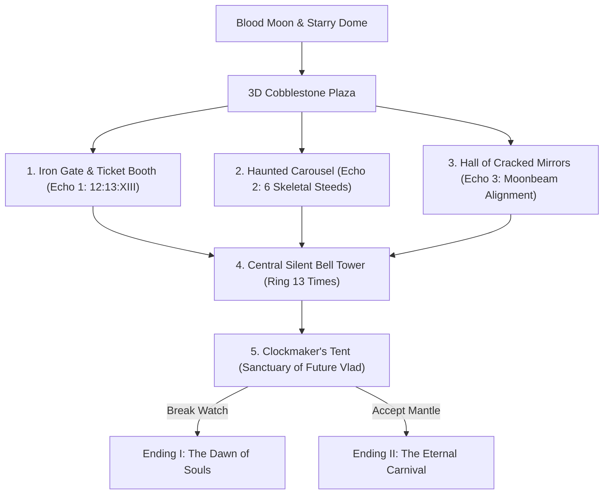

<<<<<<< HEAD
# THE 13TH HOUR — 3D Gothic Horror-Adventure
> **An Interactive 3D Gothic Mystery in Suspended Time**

---

## 🌒 Synopsis

**THE 13TH HOUR** is an interactive 3D gothic horror-adventure game about **Vlad**, an immortal vampire who discovers an antique magical pocket watch called the **Chronos Heart**.

When opened at exactly **12:13**, the watch's circular glass face reveals not gears, but an entire 3D haunted Victorian carnival trapped inside. Vlad steps through a miniature iron gate into a repeating **ten-minute time loop** (12:13 to 12:23).

His special ability is the Chronos Heart, allowing him to **rewind 3D time by 13 seconds** to avert fatal errors, correct puzzle moves, and escape traps. Vlad must explore the 3D carnival plaza, investigate mysterious objects, and recover **three lost memory echoes**:
1. **The Old Invitation Ticket** *(Ticket Booth)*
2. **The Stopped Carousel** *(Skeletal Carousel)*
3. **The Cracked Mirror** *(Hall of Mirrors)*

Once all three echoes are gathered, Vlad must ring the **Silent Bell thirteen times** in the center belfry. The thirteenth chime shatters the temporal seal on the Clockmaker's grand pavilion. Inside, Vlad discovers the Clockmaker is his **future self**, who created the time loop a century ago to protect trapped souls from an inferno. 

Vlad faces the ultimate choice:
* **Shatter the Chronos Heart** to free the souls and let the carnival dissolve into dawn.
* **Become the New Keeper** to preserve the carnival forever in an eternal loop.

---

## 🕹️ 3D Controls

| Action | Keyboard / Mouse | Description |
| :--- | :--- | :--- |
| **Walk** | `W` `A` `S` `D` / Arrows | Move Vlad in full 3D space |
| **Rotate Camera (Look)** | **Left-Click + Drag Mouse** | 360° orbit around Vlad |
| **Zoom Camera** | **Mouse Wheel** | Zoom in / out |
| **Jump** | `Space` | Leap over obstacles |
| **Interact / Inspect** | `E` | Engage with nearby landmarks |
| **Chronos Heart Rewind (13s)** | Hold `R` (or click HUD button) | Reverse 3D time with ghost clones |
| **Toggle Gothic Audio** | `M` | Mute / Unmute procedural pipe organs & bells |

---

## 🎪 3D World Landmarks & Puzzles

1. **The Iron Gate & Ticket Booth (Echo 1)**:
   * Approach the wooden booth with the glowing "12:13" sign. Press `[E]` to align the three brass dials to `12 : 13 : XIII`.
2. **The Haunted Carousel (Echo 2)**:
   * Six 3D skeletal horses bobbing on brass poles beneath a striped canopy. Pull the drive lever and lock the gears at 180° (use `[R]` to rewind if you miss). Once fixed, the carousel spins to life!
3. **The Hall of Cracked Mirrors (Echo 3)**:
   * Full-height antique mirrors reflecting volumetric moonbeams. Rotate the shards to deflect light into the center Shattered Heart.
4. **The Silent Bell Tower (13 Tolls)**:
   * Stand in the central plaza and press `[E]` thirteen times. The 3D bell swings realistically with each chime, pulsing golden shockwaves across the cobblestones until the tent gears unlock.
5. **The Clockmaker's Sanctuary & Endings**:
   * Step inside the opened velvet curtains for the dramatic confrontation with Future Vlad and choose the carnival's fate.

---

## 📦 How to Play

* **3D Version (Default):** Double-click [`index.html`](file:///C:/Users/victus/.gemini/antigravity/scratch/the-13th-hour/index.html).
* **Classic 2D Version:** Double-click [`index_2d.html`](file:///C:/Users/victus/.gemini/antigravity/scratch/the-13th-hour/index_2d.html).
=======
# THE-13TH-HOUR
>>>>>>> d3d83f66925c6756eefcaf945374f7a6a89a15ed
